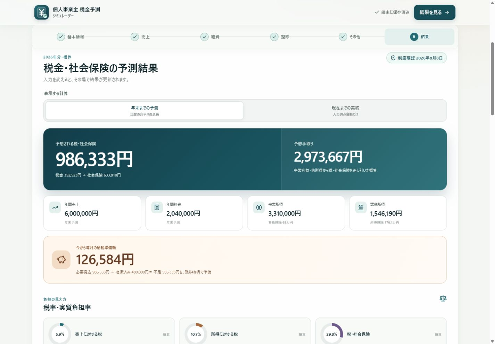

# 個人事業主 税金予測シミュレーター

> **Concept Project / 自主制作** — 実在の税務サービスや受託案件ではなく、複雑な制度を説明可能な計算ロジックとUIへ落とし込む力を示すポートフォリオ作品です。

現在までの売上・経費・所得控除・社会保険料などから、2026年分の税金と社会保険の年間負担をリアルタイムに概算する、個人事業主・フリーランス向けWebアプリです。

確定申告書を作るサービスではありません。「今のペースが年末まで続いたら、いくら支払う可能性があり、今から毎月いくら確保すればよいか」を早めに把握するための納税準備ツールです。

## Demo

**公開デモ：<https://freelance-tax-kj-019fe135.web.app>**

- 対応年度: 2026年分（令和8年分）
- 税制最終確認日: 2026-08-08
- データ保存: ブラウザのlocalStorageのみ（税務データをサーバーへ送信しません）

## Screenshots

### 入力と概算結果


### 税金・社会保険の結果



### スマートフォン入力


## 想定ユーザー

- 日本国内の個人事業主・フリーランス
- 開業したばかりで年間負担の見通しを持ちたい人
- 青色申告・白色申告の事業者
- 副業の事業所得がある会社員
- インボイス登録後の消費税負担を概算したい人

税務用語に詳しくなくても、基本情報、売上、経費、控除、その他、結果の順に入力できるステップ形式です。氏名、住所、マイナンバー、口座情報は入力しません。

## 主な機能

- 「現在までの実績」と「年末までの予測」の切り替え
- 累計額だけの簡単入力と、1〜12月の月別売上・経費科目を使う詳細入力
- 所得税、復興特別所得税、住民税、個人事業税、消費税、国民健康保険、国民年金の内訳表示
- 年間売上、年間経費、事業所得、課税所得、税・社会保険、予想手取りの一覧
- 売上・所得に対する税負担率と、社会保険を含む実質負担率
- 1〜12月の売上・経費・利益・積立目安グラフと表（実績／予測を区別）
- 現在の確保済み資金を差し引いた、残り期間の毎月の準備目安
- 追加経費、小規模企業共済、iDeCoの4シナリオ比較
- 一般的な納税時期を示すタイムライン
- 各税目の「なぜこの金額？」と、計算根拠・公的出典の展開表示
- 年商300万円、600万円、1,000万円、1,500万円の架空サンプル
- 入力と同時の再計算、350ms後のlocalStorage自動保存、保存データの削除
- PC、タブレット、スマートフォン向けレスポンシブ表示
- キーボード操作、可視フォーカス、フォームラベル、aria属性、reduced motionへの配慮

## 対応している入力

### 事業・申告

対象年度、現在月、開業年月、都道府県、市区町村、年齢、青色／白色申告、青色申告特別控除（10万円・55万円・65万円）を入力できます。

### 売上・所得

- 現在までの売上累計、または1〜12月の月別売上
- その他事業収入
- 売上返品・値引き
- 給与所得額（給与収入ではなく、給与所得控除後の金額を直接入力）
- その他の総合課税所得

### 経費

簡単入力では現在までの経費合計を使います。詳細入力では、仕入高、外注費、地代家賃、水道光熱費、通信費、広告宣伝費、消耗品費、旅費交通費、接待交際費、車両費、会議費、支払手数料、租税公課、減価償却費、専従者給与、その他経費を入力できます。

### 所得控除・社会保険

基礎控除は合計所得から自動判定します。社会保険料控除は、入力した国民健康保険または会社の社会保険に、選択時は2026年暦年の国民年金を加えて求めます。次の項目は、証明書や公的試算で確認した年間の控除額を直接入力します。

- 小規模企業共済等掛金控除
- iDeCo掛金
- 生命保険料控除
- 地震保険料控除
- 医療費控除
- 配偶者控除
- 配偶者特別控除
- 扶養控除
- 寄附金控除
- 障害者控除
- ひとり親控除
- 寡婦控除
- 勤労学生控除
- 雑損控除
- その他の所得控除

国民健康保険は自治体、前年所得、世帯構成などによる差が大きいため、年間見込額をユーザーが入力します。会社員の副業などでは、給与から負担する社会保険料の年間見込額を直接入力するか、社会保険を計算から除外できます。

ふるさと納税額には参考入力欄がありますが、上限判定や住民税の特例控除は計算へ反映しません。計算へ含める場合は、公的資料等で確認した寄附金控除額を別欄へ入力してください。

## 2026年分の税制設定

税率や控除額は src/lib/tax/taxRules/2026.ts に集約し、計算処理とUIから分離しています。

### 所得税

- 合計所得4,890,000円以下の基礎控除は1,040,000円
- 以後、合計所得6,550,000円以下は670,000円、23,500,000円以下は620,000円、24,000,000円以下は480,000円、24,500,000円以下は320,000円、25,000,000円以下は160,000円、25,000,000円超は0円
- 課税所得は1,000円未満を切り捨て、5%〜45%の7段階の超過累進税率を速算控除方式で計算
- 復興特別所得税は所得税額の2.1%（1円未満切り捨て）
- 青色申告特別控除は選択した10万円・55万円・65万円のうち、正の事業利益を上限に適用

### 住民税

- 所得割は標準税率10%で概算
- 基礎控除は合計所得24,000,000円以下430,000円、24,500,000円以下290,000円、25,000,000円以下150,000円、それを超える場合0円
- ユーザーが計上を選んだ場合、均等割4,000円と森林環境税1,000円を加算
- 2026年中の所得に対する2027年度課税の見込みとして表示

自治体独自の税率・均等割、非課税判定、調整控除、税額控除は自動判定しません。また、入力された所得控除額を住民税でも共通額として使う標準近似です。

### 個人事業税

- 業種判定は行わず、ユーザーが対象外・不明（0%）、3%、4%、5%から選択
- 青色申告特別控除前の事業利益から事業主控除を差し引いて概算
- 12か月営業時の事業主控除は2,900,000円。年の途中に開業した場合は、設定ファイルの月割額を適用

### 消費税

- 免税、原則課税、簡易課税、2割特例を選択可能
- 税込売上・税込課税仕入れを、標準税率10%だけの取引として内税換算
- 原則課税は入力した課税仕入れの税額を控除
- 簡易課税は事業区分ごとのみなし仕入率90%、80%、70%、60%、50%、40%の単一区分で計算
- 2割特例は「インボイス登録あり」かつ「登録がなければ免税事業者だった」をユーザーが確認した場合だけ選択可能。2026年分までの設定
- インボイス登録ありで免税を選んだ場合は、結果を0円表示しつつ要確認として警告

課税事業者該当性、届出状況、基準期間・特定期間、軽減税率、非課税・不課税取引、複数事業区分などは自動判定しません。

### 国民年金

2026年暦年は、1〜3月を月17,510円、4〜12月を月17,920円として合計213,810円を計上します。前納、付加保険料、免除、猶予、未納、実際の支払日は反映しません。

## 計算ロジック

税計算は src/lib/tax 以下の純粋関数へ分離しています。

1. 売上と経費を実績値のまま使うか、現在までの営業月数から年末まで年換算します。
2. 売上 − 経費で青色申告特別控除前の事業利益を求めます。
3. 青色申告の場合、正の事業利益を上限に選択した特別控除を差し引きます。
4. 事業所得、給与所得、その他所得を合算し、0円未満にならない範囲で合計所得を求めます。
5. 基礎控除、社会保険料、直接入力されたその他の所得控除を差し引き、課税所得を求めます。
6. 所得税、復興特別所得税、住民税、個人事業税、消費税を別々に計算します。
7. 税金と社会保険の合計を年間負担とし、現在確保済み資金との差額を残り月数で割って毎月の準備目安を出します。

簡単入力の年末予測は、現在までの累計額を経過営業月数で割り、その年の営業月数へ延長します。詳細入力では、現在月までの月別売上平均で未入力の将来月を補い、入力済みの将来月はその値を使います。詳細入力のその他事業収入と返品・値引きは一度だけ加減し、経費科目合計は経過営業月数から年換算します。開業前の月は0円です。

予想手取りは、青色控除前の事業利益＋給与所得＋その他所得−税金−社会保険の概算です。現在確保済み資金や、既存の控除入力に伴う実際の現金支出は差し引きません。シナリオ比較では、追加した共済・iDeCo掛金を手元資金から別途差し引いて表示します。

## 計算上の前提

- 現在までの実績モードで年換算しないのは事業売上と事業経費です。給与所得、その他所得、控除、国保・会社の社会保険は年間額として両モードで使い、国民年金も2026年暦年の全額を計上します。
- 年末予測は現在までのペースが続く単純予測です。季節変動、契約済み案件、物価変動は、詳細入力で将来月の売上を明示しない限り予測しません。
- 消費税では、予測した事業売上の全額を標準税率10%の税込課税売上と仮定します。原則課税の課税仕入れはユーザーが入力した年間額をそのまま使います。
- 金額入力は0円以上として扱います。事業利益は赤字になり得ますが、事業所得、給与所得、その他所得を合算した合計所得は0円未満へ下げません。
- 所得税の課税所得は1,000円未満、住民税所得割は計算過程で定めた単位未満、個人事業税は100円未満を切り捨てます。
- 所得控除の直接入力額は、所得税と住民税で共通利用します。実際には税目ごとに控除額や判定が異なるため、住民税は標準近似です。
- 毎月の準備目安は、年間の税・社会保険−確保済み資金を、現在月の翌月から12月までの月数で割ります。12月は0除算を避けるため1か月として表示します。
- シナリオ比較はすべて年末予測を基準にし、国民健康保険などユーザー入力の固定額が所得変化に連動する再計算は行いません。

## 対応していないケース・既知の簡略化

- 2026年分以外の年度
- 確定申告書の作成、電子申告、納税、税務判断
- 給与収入から給与所得控除後の給与所得を求める計算
- 国民健康保険の自治体別・世帯別自動計算
- 住民税の自治体差、非課税判定、調整控除、各種税額控除、控除額差
- 配偶者・扶養・障害・医療費などの控除要件と上限の自動判定
- ふるさと納税の上限、所得税還付、住民税基本分・特例分、ワンストップ特例
- 個人事業税の法定業種判定、非課税所得・損失等の個別調整
- 消費税の課税事業者判定、届出期限、課税売上割合、簡易課税の適用可否、複数事業区分、軽減税率、非課税・不課税、インボイス経過措置の詳細
- 源泉徴収税額、予定納税、中間申告、延納、還付、税額控除
- 住宅ローン控除、外国税額控除などの税額控除
- 土地・建物・株式・先物・退職・山林などの分離課税
- 純損失の繰越・繰戻し、前年以前の損失、災害などの特殊計算
- 専従者給与や青色申告65万円控除の適用要件の自動確認
- 前納・免除等を含む国民年金の個別事情
- 実際の納付日や自治体ごとの納期の確定

入力欄に金額を入れられる項目でも、法的な適用要件を満たすかはアプリが保証しません。公的資料、税務署、自治体、税理士等で確認した金額を入力してください。

## Architecture / Design Decisions

```text
入力UI → 年度別税制設定 → 純粋な計算関数 → 集計・比較結果 → 画面表示
  └────────────────────────────────────────→ localStorage（同一ブラウザのみ）
```

- 税制値を`src/lib/tax/taxRules`へ年度別に分離し、画面コードへ税率や控除額を散在させません。
- 税目ごとの計算を純粋関数に分け、税率境界、控除、年末予測、シナリオ比較を自動テストできる構成にしています。
- 入力データと計算はブラウザ内だけで扱い、認証、データベース、外部APIを必要としません。

## 使用技術

- Next.js 16.3（App Router、static export）
- React 19.2
- TypeScript 5.9
- Recharts 3.10
- Lucide React 1.28
- Vitest 4.1、Testing Library
- ESLint 9
- Firebase Hosting / Firebase CLI
- CSS（レスポンシブ、可視フォーカス、reduced motion）

サーバー処理、認証、データベースは使用していません。next build が生成する out ディレクトリをFirebase Hostingで配信します。

## 専用アイコン

public/icons/tax-simulator.svg に、円マーク、電卓を思わせる角丸枠、右上がりの予測矢印を組み合わせたSVGアイコンを用意しています。PWA・Apple touch icon向けに180px、192px、512pxのPNGも生成し、ヘッダー、フッター、Web App Manifest、faviconで共通利用します。

## 環境構築

必要環境はNode.js 20.9.0以上です。

~~~bash
npm install
npm run dev
~~~

開発サーバーの案内に表示されたローカルURLを開いてください。

## Environment Variables

実行時の環境変数はありません。税額計算、サンプルデータ、保存処理はすべてブラウザ内で完結します。Firebase CLIは静的成果物をHostingへ配置するためだけに使用し、Firebase AuthenticationやFirestoreの設定値は使用しません。

## 品質確認

~~~bash
npm run lint
npm run typecheck
npm run test
npm run build
~~~

すべてを順に実行する場合は次のコマンドを使います。

~~~bash
npm run verify
~~~

テストでは、所得税率と基礎控除の境界、青色申告特別控除、復興特別所得税、住民税、個人事業税、消費税の各方式、国民年金、実績・年間予測、開業年の月割、月別集計、納税資金、シナリオ比較を検証します。

2026-08-08の最終確認では、ESLint、TypeScript、84件のユニットテスト、static buildがすべて成功しました。詳細は docs/MANUAL_QA.md を参照してください。

## ビルドとローカルプレビュー

~~~bash
npm run build
npm run preview
~~~

静的成果物は out に出力され、Firebase Hosting Emulatorは http://127.0.0.1:5006 で起動します。

## デプロイ

Firebase CLIでログインし、対象プロジェクトとHostingサイトの設定・権限を確認してから実行します。

~~~bash
npm run hosting:deploy
~~~

`.firebaserc.example`を`.firebaserc`へコピーし、対象プロジェクトIDを設定してから、`firebase use`で選択内容を確認してください。`hosting:deploy`は`firebase.json`に記載した専用Hostingサイトだけを対象にします。プロジェクトを確認せずに実行しないでください。

## 翌年度税制への更新方法

1. 国税庁、財務省、総務省、日本年金機構、対象自治体の一次資料で新年度制度を確認します。
2. src/lib/tax/types.ts のSUPPORTED_TAX_YEARSとTaxYearへ年度を追加します。
3. src/lib/tax/taxRules/2026.tsを参考に、新しい年度ファイルを追加します。
4. 基礎控除、所得税率、住民税標準値、個人事業税事業主控除、消費税特例、国民年金、公的出典URL、確認日を更新します。
5. src/lib/tax/taxRules/index.tsへ新年度設定を登録します。
6. 年度選択UI、表示文言、マニフェスト、保存データの税制バージョンを更新します。
7. すべての税率境界と適用条件のテストを追加し、既存2026年テストが変わらないことを確認します。
8. npm run verify と実ブラウザ確認を行い、READMEの対応範囲・簡略化・確認日を更新します。

税制設定だけで表現できない制度変更がある場合は、既存年度の関数を変更して結果を崩さず、年度別の計算戦略を追加してください。

## 参照した公的情報

すべて2026-08-08に最終確認しています。

- [令和8年度税制改正による所得税の基礎控除の引上げ等について（国税庁）](https://www.nta.go.jp/users/gensen/2026kiso/index.htm)
- [所得税の税率（国税庁 No.2260）](https://www.nta.go.jp/taxes/shiraberu/taxanswer/shotoku/2260.htm)
- [青色申告特別控除（国税庁）](https://www.nta.go.jp/taxes/shiraberu/taxanswer/shotoku/2072.htm)
- [個人の方に係る復興特別所得税のあらまし（国税庁）](https://www.nta.go.jp/publication/pamph/shotoku/fukko_tokubetsu/index.htm)
- [個人住民税（東京都主税局）](https://www.tax.metro.tokyo.lg.jp/kazei/life/kojin_ju)
- [個人事業税（東京都主税局）](https://www.tax.metro.tokyo.lg.jp/kazei/work/kojin_ji)
- [2割特例の概要（国税庁）](https://www.nta.go.jp/publication/pamph/shohi/kaisei/202304/01.htm)
- [簡易課税制度（国税庁 No.6505）](https://www.nta.go.jp/taxes/shiraberu/taxanswer/shohi/6505.htm)
- [国民年金保険料（日本年金機構）](https://www.nenkin.go.jp/service/kokunen/hokenryo/hokenryo.html)
- [主な国税の納期限（法定納期限）及び振替日（国税庁）](https://www.nta.go.jp/taxes/nozei/nofu/24200042/noufu_kigen.htm)

## プライバシー

入力値は freelance-tax-simulator:v1 としてブラウザのlocalStorageへ保存されます。計算はブラウザ内で完結し、アプリ自身は入力値をサーバー、Firebase Authentication、Firestore、アクセス解析サービスへ送信しません。共有端末では、利用後に「保存データを削除」またはブラウザのサイトデータ削除を実行してください。

## 免責事項

本サービスの計算結果は納税準備のための概算です。実際の税額は所得状況、控除、自治体、税制改正、申告内容などにより異なります。確定申告や具体的な税務判断については、国税庁・税務署・自治体・税理士等へご確認ください。

## License / Asset Origin

このリポジトリには`LICENSE`ファイルを設定していません。ソースコード、文章、専用アイコン、スクリーンショットの著作権は制作者に留保され、無断での再利用・再配布はできません。依存パッケージには、それぞれのライセンスが適用されます。
